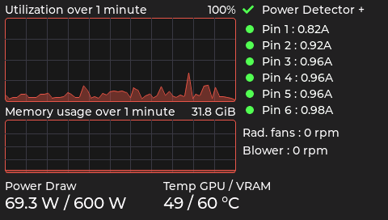
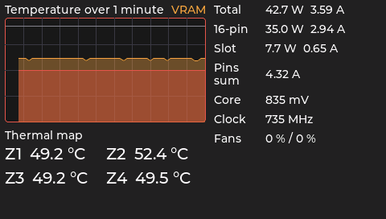
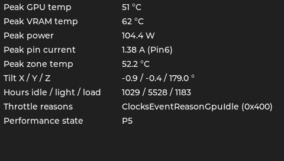
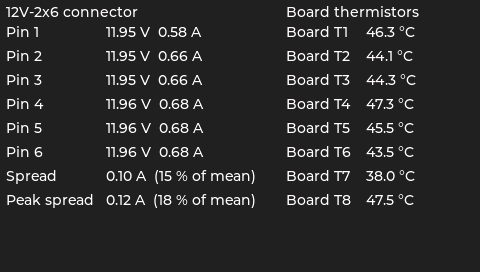
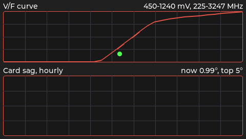
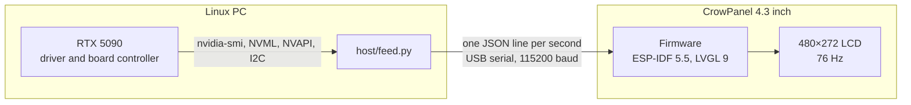

<h1 align="center">CrowPanel GPU monitor</h1>

<p align="center">
  A 4.3" touch panel that shows what an ASUS ROG Astral RTX 5090 is doing,<br>
  down to the current on every pin of its power connector.
</p>

<p align="center">
  
  
  
  
</p>

<p align="center">
  
</p>

A small Python script on the PC reads the card's sensors and sends them over USB serial once a second.
The panel, an Elecrow CrowPanel with an ESP32-S3, draws them on seven pages.
There is no Wi-Fi, no server and no Python package to install: one USB cable carries power, firmware and data.

These pictures are not mock-ups. They were read out of the panel's framebuffer with [`host/shot.py`](#screenshots).

> An unofficial hobby project, not affiliated with ASUS, NVIDIA or Elecrow.

## What it shows

| | |
| --- | --- |
|  |  |
| **Page 2**: temperature history, thermal map, power split | **Page 3**: peaks, tilt, operating hours |
|  |  |
| **Page 4**: connector health, board thermistors | **Page 7**: voltage/frequency curve, card sag |

- **Power Detector+**: the current on each of the six 12V-2x6 pins, as in ASUS GPU Tweak III.
  A pin turns red above 9.2 A or when it carries no current at all.
- **One-minute charts** for utilization, memory, GPU and VRAM temperature.
- **Thermal map**: the four temperature zones of the card's own board sensors.
- **Power**: total draw against the limit, and how it splits between the 16-pin cable and the slot.
- **Warnings**: throttling (power cap, thermal, hardware slowdown) and a card that hangs more than 3° off level.
- **Peaks** since the feed started, card tilt, and the card's hours at idle, light load and load.
- **Fan speeds** of the radiator fans and the blower, core voltage, clock and performance state.
- **Connector health** (page 4): volts and amps per pin, the spread between the highest and lowest pin with its
  peak, and all eight board thermistors behind the thermal map.
- **System** (page 5): PCIe link speed and width with a warning when the card runs on fewer lanes than it has,
  PCIe error counters, encoder and decoder load, energy used since the feed started, CPU load and temperature.
- **Limits** (page 6): power target range, clock offset ranges, temperature limits, and the three programs
  holding the most video memory.
- **Curves** (page 7): the driver's voltage/frequency curve with a dot where the card is right now, and the
  card's sag, sampled once an hour and kept across reboots.

Swipe sideways to change page. Hold a finger still for one second to turn the picture upside down;
the panel remembers it.

## How it works



The feed decides what is a peak and what is a warning; the firmware only draws what it is sent and shows `--`
for anything missing. The wire format, the measurements behind the display settings and the rules of each
widget are in [`HARDWARE.md`](HARDWARE.md).

## What you need

- An Elecrow CrowPanel 4.3" (ESP32-S3, 480×272, resistive touch) on a USB port
- A Linux PC with an NVIDIA card and the proprietary driver
- Python 3 for the feed, with no extra packages
- ESP-IDF v5.5 to build the firmware

The pin currents, thermal map, tilt and hours need an ASUS Astral.
Other NVIDIA cards get the rest; see [Another graphics card](#another-graphics-card).

## Setup

Tested on Fedora 45. Steps 1 and 2 were written down from a working machine, not re-run from scratch.

```sh
git clone https://github.com/sm00thelf/crowpanel-astral-monitor.git ~/GitHub/crowpanel-astral-monitor
cd ~/GitHub/crowpanel-astral-monitor
```

The systemd unit in step 5 expects the repo at that path.

### 1. Serial port

The panel's USB port is a CH340 serial bridge and shows up as `/dev/ttyUSB0`. Give your user access to it:

```sh
sudo usermod -aG dialout $USER     # then log out and back in
```

### 2. ESP-IDF v5.5.3

```sh
mkdir -p ~/esp && cd ~/esp
git clone -b v5.5.3 --recursive https://github.com/espressif/esp-idf.git
cd esp-idf && ./install.sh esp32s3
```

<details>
<summary>The installer fails on Python 3.15</summary>

If your system Python is that new, put 3.13 first on the path, for the installer and for every later use:

```sh
mkdir -p ~/.espressif/pybin
ln -s /usr/bin/python3.13 ~/.espressif/pybin/python3
ln -s /usr/bin/python3.13 ~/.espressif/pybin/python
export PATH=$HOME/.espressif/pybin:$PATH
```

</details>

### 3. Build and flash

Flashing replaces the firmware the panel came with. It is not in this repo, so back it up first if you want it:

```sh
python3 -m esptool --port /dev/ttyUSB0 read-flash 0 0x400000 backup.bin
```

Then, in the repo:

```sh
export PATH=$HOME/.espressif/pybin:$PATH     # only if you needed the Python 3.13 workaround
. ~/esp/esp-idf/export.sh
idf.py build
idf.py -p /dev/ttyUSB0 flash
```

The panel now shows its pages without values, and "no data" in the corner.

### 4. Feed requirements on the PC

`host/feed.py` needs:

- the NVIDIA driver with `nvidia-smi`, `libnvidia-ml.so.1` and `libnvidia-api.so.1`
  (Fedora: `xorg-x11-drv-nvidia-libs`, tested with driver 620.70.06)
- for the pin currents, thermal map, tilt and hours: the `i2c-dev` kernel module and read-write access to the
  GPU's `/dev/i2c-N`. On the test machine fwupd loads the module at boot
  (`/usr/lib/modules-load.d/fwupd-i2c.conf`) and the `openrgb-udev-rules` package gives the logged-in desktop
  user the I2C devices. Without them those rows show `--` and everything else still works.

Check with:

```sh
python3 host/feed.py --selftest
python3 host/feed.py --dry-run     # prints the frames instead of sending them
```

### 5. Run the feed

By hand:

```sh
python3 host/feed.py
```

Add `--price 0.35` to see on page 5 what the card's energy has cost at that price per kWh.

Or from every login on, as a systemd user unit:

```sh
systemctl --user enable --now ~/GitHub/crowpanel-astral-monitor/host/crowpanel-feed.service
```

Run only one feed at a time, and stop it before flashing, because both use the same serial port:

```sh
systemctl --user stop crowpanel-feed
```

## Screenshots

`host/shot.py` asks the firmware for its framebuffer and saves it as a PNG. The feed can keep running.
It takes about 25 seconds, and the panel misses the feed's frames meanwhile.

```sh
python3 host/shot.py page1.png
python3 host/shot.py --page 4 page4.png     # switches the panel to page 4 first
```

## Troubleshooting

| Symptom | Cause and fix |
| --- | --- |
| Panel shows "no data" | No frame arrived for 5 seconds. Check that the feed runs: `systemctl --user status crowpanel-feed` |
| `Permission denied` on `/dev/ttyUSB0` | Your user is not in `dialout`, or you have not logged in again since joining it |
| Pins, thermal map, tilt or hours show `--` | No access to the GPU's `/dev/i2c-N`, or not an Astral card; see [step 4](#4-feed-requirements-on-the-pc) |
| Flashing fails | The feed may hold the serial port: `systemctl --user stop crowpanel-feed` |
| A change in `sdkconfig.defaults` has no effect | Delete `sdkconfig` and build again |
| Values wrong or missing after an NVIDIA driver update | The struct layouts read from `libnvidia-api` were found by probing driver 620.70.06. Run `python3 host/gpuz.py --selftest` |
| Taps land in the wrong place | Calibrate the touch panel, see below |

## Another graphics card

The feed is written for the ASUS Astral. On any other NVIDIA card the charts, power, temperatures and fan
speeds still work, but the pin currents, thermal map, tilt and hours are missing: they come from the Astral's
board controller. The fan labels "Rad. fans" and "Blower" in `main/monitor.c` are for the liquid-cooled model.

## Another panel: touch calibration

The constants in `main/board.h` were measured on one unit. If taps land in the wrong place:

1. In `touch_calibrate` in `main/main.c`, log the raw values before they are mapped:
   `ESP_LOGI(TAG, "raw %u %u", x[0], y[0]);`
2. Flash, run `idf.py -p /dev/ttyUSB0 monitor`, and press a stylus 30 px in from each corner.
3. Raw X and Y each change linearly with the pixel position. Extrapolate the readings to the screen edges
   (pixel 0 and 479, 0 and 271) and put the four values into `TOUCH_RAW_*` in `main/board.h`.
4. Remove the log line again.

On the measured unit raw X runs left to right, the opposite of Elecrow's defaults.

## What is where

| Path | What |
| --- | --- |
| `main/` | Firmware. `monitor.c` is the UI and the serial receiver, `board.h` the pins and touch calibration |
| `host/feed.py` | Runs on the PC and sends the readings |
| `host/shot.py` | Saves a screenshot of the panel as a PNG |
| `host/gpuz.py` | Sensor collector, an unchanged copy from my GPU Tweak III reverse-engineering notes. Those notes are not published, so its "RE doc" references point nowhere |
| `host/crowpanel-feed.service` | systemd user unit for the feed |
| [`HARDWARE.md`](HARDWARE.md) | Board identification, measurements, wire format, details of each feature |

## License

MIT, see [`LICENSE`](LICENSE). The components in `main/idf_component.yml` are downloaded at build time and keep
their own licenses.
